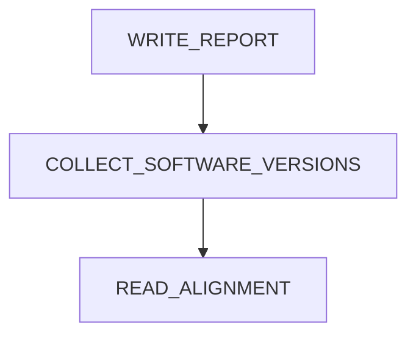

# Main

See the NOTICE file distributed with this work for additional information
regarding copyright ownership.
Licensed under the Apache License, Version 2.0 (the "License");
you may not use this file except in compliance with the License.
You may obtain a copy of the License at
http://www.apache.org/licenses/LICENSE-2.0
Unless required by applicable law or agreed to in writing, software
distributed under the License is distributed on an "AS IS" BASIS,
WITHOUT WARRANTIES OR CONDITIONS OF ANY KIND, either express or implied.
See the License for the specific language governing permissions and
limitations under the License.
ENSEMBL READ ALIGNMENT PIPELINE
This Nextflow DSL2 workflow performs alignment of RNA sequencing reads
against reference genome assemblies using STAR and Minimap2.
The pipeline supports short-read and long-read sequencing technologies,
automatically selects the appropriate aligner based on the sequencing
platform, and generates indexed BAM alignment files.
Optional downstream processing includes tissue-level BAM merging,
stranded BAM generation, BigWig coverage tracks, and CRAM conversion.
Pipeline Stages:
1. FETCH_GENOME
Retrieve or locate reference genome assemblies specified in the
input CSV metadata file.
2. DOWNLOAD_FASTQS
Download sequencing reads and prepare FASTQ files for alignment.
Validate the presence of required FASTQ files.
3. PLATFORM SELECTION
Select the appropriate alignment workflow:
- Illumina: STAR
- PacBio / PacBio SMRT / ONT: Minimap2
4a. STAR_INDEX_PARAMS
Calculate genome statistics and prepare STAR indexing parameters
for Illumina sequencing data.
4b. STAR_INDEX_GENOME
Generate the STAR genome index.
4c. STAR
Align Illumina RNA sequencing reads against the reference genome
and produce BAM alignment files.
5a. MINIMAP2_INDEX_GENOME
Generate the Minimap2 reference genome index.
5b. MINIMAP2
Align PacBio and Oxford Nanopore reads against the reference
genome and produce BAM alignment files.
6. CHECK_BAM
Validate alignment BAM files produced by STAR and Minimap2.
Only validated BAM files proceed to downstream processing.
7. DELETE_FASTQ
Perform FASTQ cleanup after successful BAM validation.
8. INDEX_BAM
Generate BAI index files for validated BAM alignments.
9. MERGE_BAM_PER_TISSUE
Optionally merge BAM files belonging to the same taxon,
sequencing platform, and tissue.
Enabled with:
--mergeTissue
Merged BAM files are validated and indexed before further
downstream processing.
10. BAM2STRAND
Optionally generate forward- and reverse-strand BAM files.
Enabled with:
--stranded
11. BAM2BIGWIG
Optionally generate BigWig coverage tracks.
Enabled with:
--bam2bigWig
When stranded processing is enabled, BigWig generation
receives forward- and reverse-strand BAM files.
Otherwise, it receives the original or merged BAM files.
12. BAM2CRAM
Optionally convert original or merged BAM files into CRAM
format for compressed alignment storage.
Enabled with:
--bam2cram
13. INDEX_CRAM
Generate CRAI index files for CRAM outputs.
14. WRITE_REPORT
Generate a final report using metadata collected from
completed alignment and downstream processing steps.
15. COLLECT_SOFTWARE_VERSIONS
Collect and consolidate software version information
from the executed modules.
Input:
CSV metadata file containing:
- taxon_id
- assembly_accession
- platform
- paired
- tissue
- run_accession
- pair1
- md5_1
- pair2
- md5_2
- genome_file
Rows without taxon_id, run_accession, or pair1 are filtered
out before processing.
The genome_file field can provide a reference genome path.
Otherwise, the pipeline uses params.genome_file or retrieves
the reference genome through FETCH_GENOME.
Output:
Depending on the enabled processing options:
- Retrieved reference genome assemblies
- Downloaded FASTQ files
- STAR genome indexes
- Minimap2 genome indexes
- Aligned BAM files
- BAM index files (BAI)
- Tissue-merged BAM files
- Forward- and reverse-strand BAM files
- BigWig coverage tracks
- Compressed CRAM alignment files
- CRAM index files (CRAI)
- Final alignment report
- Consolidated software version information
Execution Parameters:
--csvFile        Input CSV metadata file
--outDir         Pipeline output directory
--genome_file    Optional reference genome file
--reuse_bam      Reuse existing BAM alignments when supported
--mergeTissue    Enable tissue-level BAM merging
--stranded       Enable stranded BAM generation
--bam2bigWig     Enable BigWig coverage track generation
--bam2cram       Enable BAM-to-CRAM conversion
Workflow Notes:
- STAR is used for Illumina sequencing data.
- Minimap2 is used for PacBio, PacBio SMRT, and ONT data.
- Both alignment branches validate and index their BAM outputs.
- Tissue merging is optional and occurs before downstream
stranded, BigWig, and CRAM processing.
- CRAM conversion uses the original or tissue-merged BAM,
independently of stranded BAM generation.
- BigWig generation uses stranded BAMs when enabled.
- Software versions are collected throughout the workflow.
- SAM2BAM is imported but is not currently executed.
- WRITE_REPORT generates the final output report.
~~~~~~~~~~~~~~~~~~~~~~~~~~~~~~~~~~~~~~~~~~~~~~~~~~~~~~~~~~~~~~~~~~~~~~~~~~~~~~~~~~~~~~
IMPORT LOCAL MODULES/SUBWORKFLOWS
~~~~~~~~~~~~~~~~~~~~~~~~~~~~~~~~~~~~~~~~~~~~~~~~~~~~~~~~~~~~~~~~~~~~~~~~~~~~~~~~~~~~~~
~~~~~~~~~~~~~~~~~~~~~~~~~~~~~~~~~~~~~~~~~~~~~~~~~~~~~~~~~~~~~~~~~~~~~~~~~~~~~~~~~~~~~~
MAIN WORKFLOW
~~~~~~~~~~~~~~~~~~~~~~~~~~~~~~~~~~~~~~~~~~~~~~~~~~~~~~~~~~~~~~~~~~~~~~~~~~~~~~~~~~~~~~

## Overview

This workflow invokes **3** modules.

## Modules

| Order | Module |
|------:|--------|
| 1 | `WRITE_REPORT` |
| 2 | `COLLECT_SOFTWARE_VERSIONS` |
| 3 | `READ_ALIGNMENT` |

## Workflow Diagram

## Source

`pipelines/read_alignment/main.nf`
