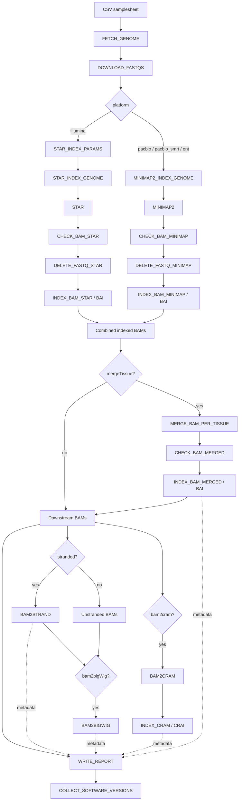

# Short Read Alignment Pipeline

## Quick links

- [Input specification](input.md)
- [Output reference](output.md)
- [Parameter reference](parameters.md)
- [Workflow documentation](workflows/index.md)
- [Module documentation](modules/index.md)
- [Troubleshooting](troubleshooting.md)

> These links assume the referenced documentation pages exist alongside this README.

## Overview

The **Short Read Alignment Pipeline** is a Nextflow DSL2 workflow for aligning sequencing reads to reference genome assemblies. Despite its name, it supports Illumina short reads and PacBio / Oxford Nanopore long reads. It retrieves or resolves genome FASTA files, downloads FASTQ inputs, chooses the appropriate aligner, checks and indexes BAMs, and optionally produces merged, stranded, CRAM, and BigWig outputs.

The entry workflow validates parameters using `nf-schema`, prints a parameter summary, and invokes `SHORT_READ_ALIGNMENT(params.csvFile)`.

## Features

- Reference genome retrieval through `FETCH_GENOME` (with optional provided genome FASTA)
- FASTQ download and paired-read checks
- STAR indexing and alignment for Illumina
- Minimap2 indexing and alignment for `pacbio`, `pacbio_smrt`, and `ont`
- BAM checks and BAI indexing on both alignment branches
- Optional tissue-level merging, followed by validation and indexing
- Optional strand-separated BAM generation
- Optional BigWig generation and BAM-to-CRAM conversion with CRAI indexing
- Final output-path reporting and aggregated software versions

## Workflow



**Interpretation:** `mergeTissue`, `stranded`, `bam2bigWig`, and `bam2cram` are conditional branches. CRAM conversion takes the downstream BAMs directly, not the strand-separated BAMs. BigWig conversion uses strand-separated BAMs when `stranded` is enabled, otherwise the downstream unstranded BAM. Software version files are collected from processes throughout execution; the final arrow is a documentation simplification, not the sole version-file dependency.

`SAM2BAM` is imported but its invocation is commented out. `INDEX_BIGWIG` is imported but not called in this workflow.

## Input specification

Provide a comma-separated CSV with a header row using `--csvFile`. The workflow filters out rows without `taxon_id`, `run_accession`, or `pair1`. Additional fields are read into sample metadata:

| CSV column | Use |
|---|---|
| `taxon_id` | Taxon identifier; required by the workflow row filter |
| `run_accession` | Sequencing run identifier; required by the row filter |
| `pair1` | First FASTQ source; required by the row filter |
| `assembly_accession` | Genome assembly accession passed as `gca` |
| `platform` | Determines STAR vs Minimap2 branch |
| `paired` | Boolean; when true, the workflow requires read 2 |
| `pair2` | Second FASTQ source for paired runs |
| `md5_1`, `md5_2` | Read checksums passed to downstream modules |
| `tissue` | Tissue label used for optional BAM grouping |
| `genome_file` | Per-row reference FASTA; falls back to `--genome_file` |

Accepted platform values (case-insensitive in `main.nf`): `illumina`, `pacbio`, `pacbio_smrt`, and `ont`. The workflow expects downloaded FASTQ names ending in `_1.fastq.gz` and, for paired runs, `_2.fastq.gz`.

The exact CSV schema and any additional validation rules are defined in `assets/schema_input.json`, which was not provided here. See [Input specification](input.md) for the complete schema when available.

## Running the pipeline

```bash
nextflow run main.nf \
  --csvFile samples.csv \
  --outDir results
```

Example with processing options explicitly enabled:

```bash
nextflow run main.nf \
  --csvFile samples.csv \
  --outDir results \
  --mergeTissue true \
  --stranded true \
  --bam2cram true \
  --bam2bigWig true
```

To disable an option, pass `--option false` (for example `--mergeTissue false`). The parameter schema declares the four options above as **true by default**, as well as `reuse_bam`. Effective values depend on how the schema and Nextflow configuration are loaded and may be overridden by command-line or configuration settings.

## Supported sequencing platforms

| Platform value | Aligner | Index preparation |
|---|---|---|
| `illumina` | STAR | `STAR_INDEX_PARAMS` → `STAR_INDEX_GENOME` |
| `pacbio` | Minimap2 | `MINIMAP2_INDEX_GENOME` |
| `pacbio_smrt` | Minimap2 | `MINIMAP2_INDEX_GENOME` |
| `ont` | Minimap2 | `MINIMAP2_INDEX_GENOME` |

## Optional processing

### Merge BAM files by tissue — `--mergeTissue`

When enabled, indexed BAMs are grouped by output directory, taxon, tissue, platform, reference FASTA, genome directory, and CSV path. `MERGE_BAM_PER_TISSUE` merges each group, followed by `CHECK_BAM_MERGED` and `INDEX_BAM_MERGED`. When disabled, indexed alignment BAMs proceed without merging.

### Stranded BAMs — `--stranded`

`BAM2STRAND` produces forward- and reverse-strand BAMs and indexes. If BigWig generation is enabled, these become the inputs to `BAM2BIGWIG`.

### BigWig coverage — `--bam2bigWig`

`BAM2BIGWIG` generates coverage outputs from either strand-separated BAMs (`--stranded true`) or the unstranded downstream BAM (`--stranded false`). The specific tool and output filenames should be confirmed against `modules/bam2bigWig.nf`.

### CRAM conversion — `--bam2cram`

`BAM2CRAM` converts downstream BAMs to CRAM; `INDEX_CRAM` then creates CRAI indexes. This branch is independent of the stranded BAM path.

### Reuse existing BAMs — `--reuse_bam`

This flag is included in per-sample metadata and passed to modules. The precise reuse behavior depends on module implementations.

## Parameter reference

The supplied JSON parameter schema declares `csvFile` and `outDir` as required. Its defaults are listed below; a blank means **no default declared in the supplied schema**.

| Parameter | Type | Schema default | Description |
|---|---|---|---|
| `csvFile` | string | — | Input CSV path; file must exist |
| `outDir` | string | — | Results directory |
| `bam2cram` | boolean | `true` | Generate CRAM and CRAI |
| `mergeTissue` | boolean | `true` | Merge BAMs by tissue grouping |
| `stranded` | boolean | `true` | Generate strand-separated BAMs |
| `bam2bigWig` | boolean | `true` | Generate BigWig coverage |
| `reuse_bam` | boolean | `true` | Request reuse of existing BAMs |
| `cleanOutputDir` | boolean | `true` | Output-directory cleanup option; not referenced directly in `main.nf` |
| `cleanCache` | boolean | — | Cache cleanup option; not referenced directly in `main.nf` |
| `cacheDir` | string | `/cache` | Cache location |
| `ftpBaseUrl` | string | `ftp://ftp.sra.ebi.ac.uk/vol1/fastq` | FASTQ FTP base URL |
| `ncbiBaseUrl` | string | `https://api.ncbi.nlm.nih.gov/datasets/v2alpha/genome/accession/` | NCBI Datasets API base URL |
| `files_latency` | integer | `60` | File-operation latency (seconds) |
| `max_intron_size` | integer | `100000` | STAR maximum intron size option |
| `limitSjdbInsertNsj` | integer | `2000000` | STAR splice-junction insertion limit |
| `genome_file` | string | — | Optional reference genome FASTA fallback |
| `enscode` | string | — | Parameter declared without description |
| `help` | boolean | — | Hidden help option |

The supplied parameter schema is not a full `nextflow.config` file. Module-level use of parameters and cleanup behavior cannot be confirmed without the corresponding module and configuration files.

## Outputs and reporting

The workflow creates or passes along these output classes:

- Aligned BAM files and BAI indexes from STAR or Minimap2
- Optionally merged BAMs and indexes
- Optionally forward/reverse stranded BAMs and indexes
- Optionally BigWig coverage outputs
- Optionally CRAM files and CRAI indexes
- A report produced by `WRITE_REPORT`, aggregating metadata by `taxon_id`, `output_dir`, and `csv_path`
- A consolidated software-version output from `COLLECT_SOFTWARE_VERSIONS`

For unmerged alignments, the workflow builds an alignment directory path of the form:

```text
<outDir>/<taxon_id>/<platform>/<run_accession>/alignment
```

For merged alignments, the metadata alignment directory is:

```text
<outDir>/<taxon_id>/<platform>/<tissue>/alignment
```

These are metadata paths constructed in `main.nf`; actual published filenames and directory layout depend on module code. Consult [Output reference](output.md) for confirmed output names.

## Validation and error handling

- `validateParameters()` validates the pipeline parameters at startup.
- Samplesheet rows missing `taxon_id`, `run_accession`, or `pair1` are filtered out.
- Missing `_1.fastq.gz` causes an explicit error; missing `_2.fastq.gz` causes an error when `paired` is true.
- STAR, Minimap2, and merged BAMs pass through `CHECK_BAM` module aliases before downstream processing.
- BAM and CRAM indexing are explicitly invoked.
- If `stranded`, `bam2cram`, and `bam2bigWig` are all disabled, `main.nf` prints a message; it does not explicitly terminate at that check.

The exact BAM-check command (for example, whether it uses `samtools quickcheck`) must be confirmed in `modules/check_bam.nf`.

## Software versions

Process version-file outputs are combined into `ch_versions_file`. At the end of the workflow, `COLLECT_SOFTWARE_VERSIONS(ch_versions_file.collect())` aggregates them. The exact name and structure of the final versions file are defined by the module.

## Module documentation

See [Module documentation](modules/index.md) for process-level inputs, outputs, commands, dependencies, and versions. The main workflow imports `FETCH_GENOME`, `DOWNLOAD_FASTQS`, `STAR_INDEX_PARAMS`, `STAR_INDEX_GENOME`, `STAR`, `MINIMAP2_INDEX_GENOME`, `MINIMAP2`, `CHECK_BAM`, `DELETE_FASTQ`, `INDEXING_FILES`, `MERGE_BAM_PER_TISSUE`, `BAM2STRAND`, `BAM2BIGWIG`, `BAM2CRAM`, `WRITE_REPORT`, and `COLLECT_SOFTWARE_VERSIONS`.

## License

Apache License, Version 2.0, as stated in the `main.nf` header.
